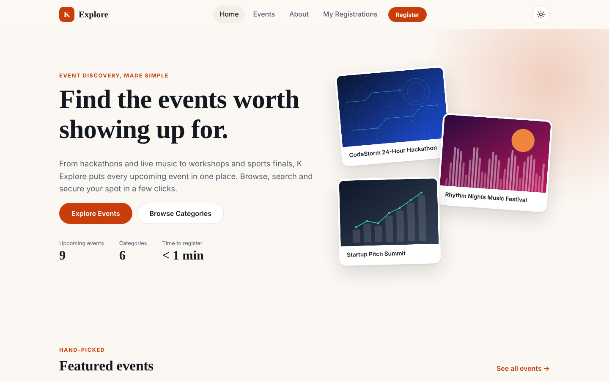
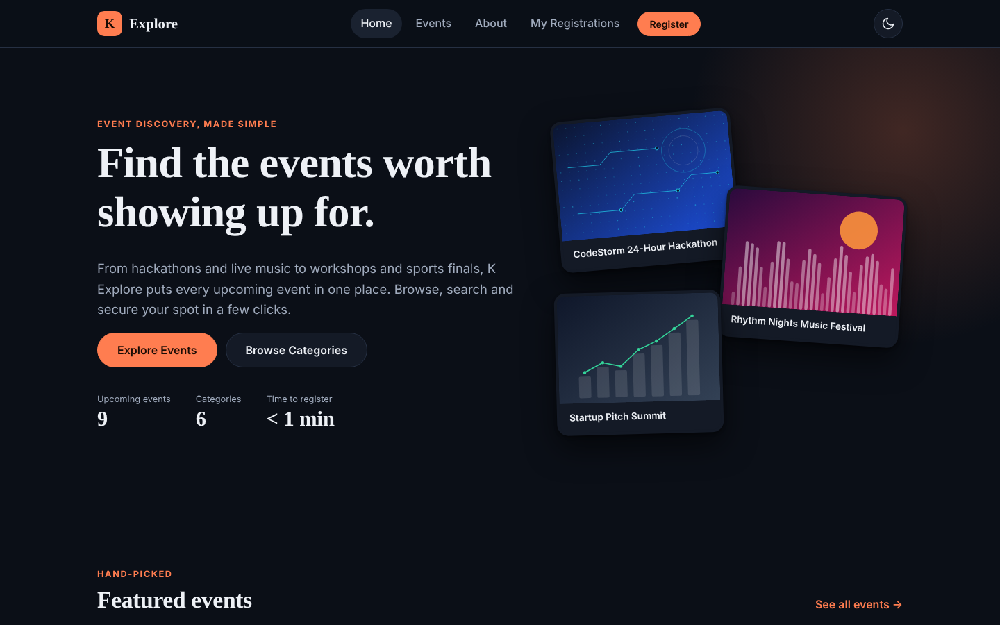
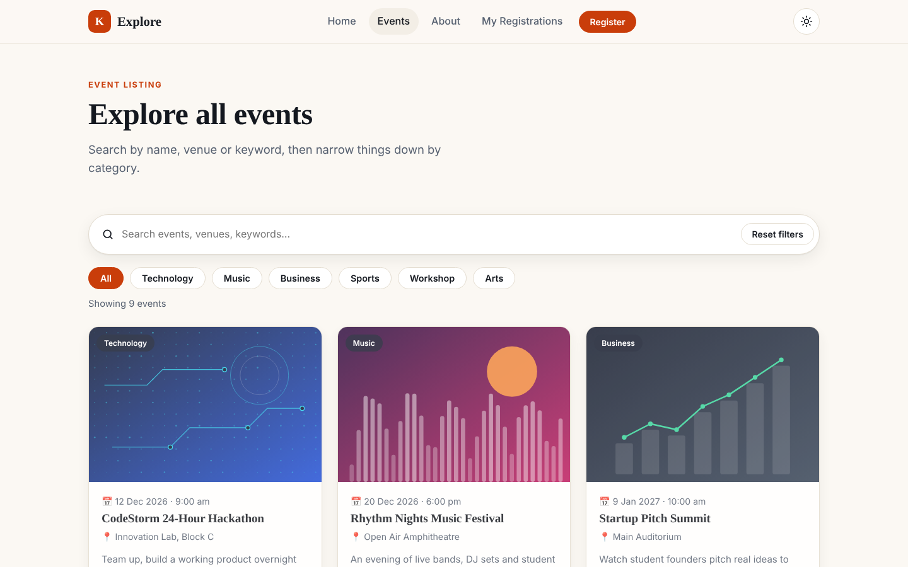
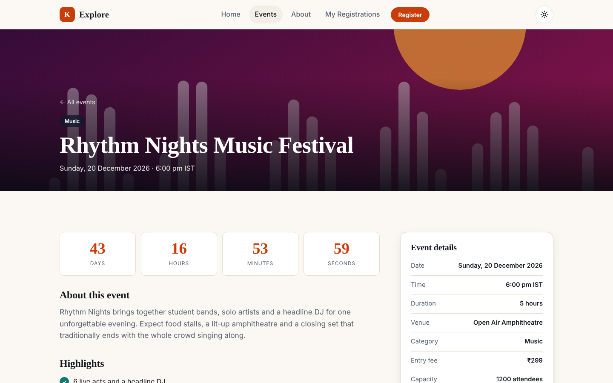
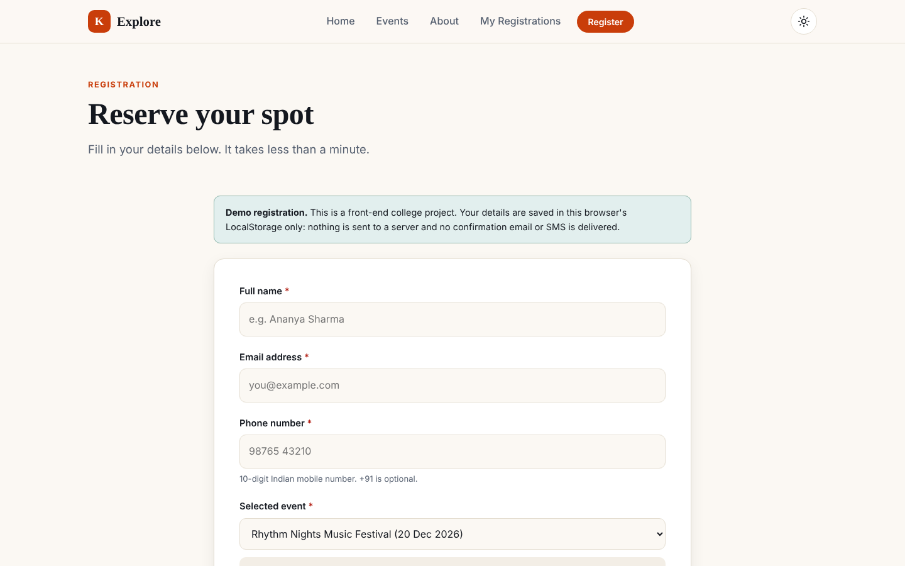
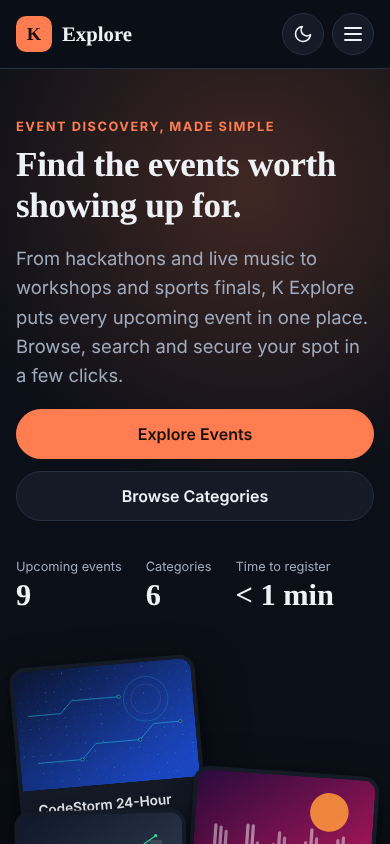
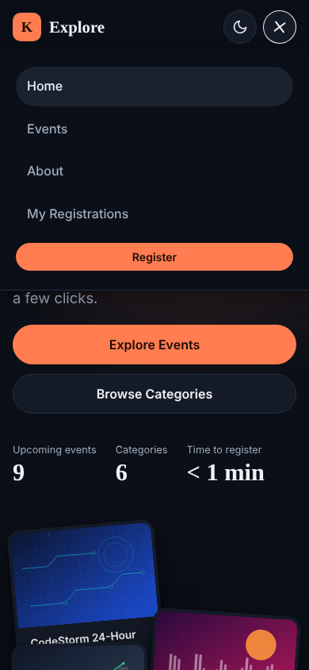

# K Explore: Event Management Website

K Explore is a responsive event discovery and registration website built with **HTML5, CSS3 and vanilla JavaScript**. Visitors can explore upcoming events, search and filter them, read full event details, watch live countdowns and register for the events they want. No build step and no dependencies.

> **Project type:** College web-designing project (front-end only).
> **Live demo:** _add your deployed URL here after deployment_
> **Repository:** _add your GitHub URL here_

## Screenshots

| Home (light) | Home (dark) |
|---|---|
|  |  |

| Event listing | Event details |
|---|---|
|  |  |

| Registration form | Mobile |
|---|---|
|  |   |

Full-page capture: [`docs/screenshots/home-full.png`](docs/screenshots/home-full.png)

## Problem statement

Campus events are usually announced through posters, group chats and notice boards, so students miss them. K Explore brings every event into one searchable, mobile-friendly place with clear details and quick registration.

## Features

**Core**
- Hero section, featured events, upcoming events, category tiles, about section and footer with contact details
- Event cards showing name, image, date, venue, short description, category and a *View Details* button
- Live **search** and **category filters** that work together, plus *Reset filters* and an empty-state message
- Event details page: image, full description, date/time, venue, category, fee, capacity, organiser, highlights, schedule and a registration button
- Registration form (name, email, phone, event) with JavaScript validation and clear inline error messages
- Success confirmation panel + toast notification, duplicate-registration protection, and a *My Registrations* page

**Bonus**
- Dark / light mode with a working toggle (saved, and follows the system preference on first visit)
- Live event countdown timers (cards and details page)
- Scroll-reveal animations, hover effects and smooth transitions (respects *reduced motion*)
- Responsive mobile navigation (hamburger menu, closes on link click or `Esc`)
- LocalStorage-based registration management (view and cancel registrations)

**Quality**
- Semantic HTML, labelled form fields, `aria-live` messages, skip link, visible focus styles, keyboard accessible
- Tested at 375 px, 768 px and 1280 px with no horizontal overflow, broken links, missing images or console errors

## Technologies

HTML5 · CSS3 (custom properties, Grid, Flexbox) · Vanilla JavaScript (ES5-style IIFEs, no modules, so it also opens from `file://`) · LocalStorage · Google Fonts (Fraunces, Plus Jakarta Sans, with system-font fallbacks) · Git/GitHub

## Project structure

```
k-explore/
├── index.html              # Home
├── events.html             # Event listing, search and filters
├── event.html              # Event details (event.html?id=<event-id>)
├── register.html           # Registration form
├── my-registrations.html   # Saved registrations
├── css/styles.css          # Design tokens, components, themes, responsive rules
├── js/
│   ├── theme.js            # Applies saved theme before first paint
│   ├── data.js             # Event + category data (edit this to add events)
│   ├── storage.js          # LocalStorage registration store
│   ├── ui.js               # Header/footer, theme toggle, toast, countdown, card renderer
│   ├── home.js  events.js  event-details.js  register.js  my-registrations.js   # page logic
├── assets/                 # favicon + event images (SVG)
├── docs/                   # requirements checklist, test report, screenshots
├── README.md
└── .gitignore
```

## Run locally

No installation is needed.

1. Download or clone the repository.
2. Open `index.html` in any modern browser, **or** serve the folder (recommended):
   ```bash
   cd k-explore
   python3 -m http.server 8000      # then visit http://localhost:8000
   # or: npx serve   /   VS Code "Live Server" extension
   ```

## How registration data is managed

> **This is a front-end demo, not a real registration backend.**

- On success, a record (`id`, event, name, email, phone, timestamp) is saved to the browser's **LocalStorage** under the key `kexplore.registrations`.
- Data stays **on that browser and device only**. There is no server or database, and no confirmation email or SMS is sent. Clearing site data removes it, and other devices cannot see it.
- **Duplicate prevention:** a registration is identified by *event ID + lower-cased email*. The same email cannot register twice for the same event, but can register for different events.
- Phone numbers are validated as 10-digit Indian mobile numbers (starting 6–9, optional `+91`/`0` prefix) and stored normalised.
- A production system would need a backend (API + database), server-side validation, email verification and authentication. See *Future improvements*.

## Adding or editing events

Open `js/data.js`, copy an existing event object, change its fields (use a unique `id`) and add an image to `assets/images/`. The dates are written in ISO format with the IST offset (e.g. `2027-01-09T10:00:00+05:30`). **Events whose start time has passed automatically show as ended and close registration**, so update the dates if you present this after the sample events have passed.

## Placeholders to personalise before submission

- Event images are original **generated SVG artwork** (no stock photos, so nothing can break or raise licensing issues). Swap in real photographs by changing each event's `image` path in `data.js`.
- Contact details in the footer (`hello@kexplore.example`, `+91 00000 00000`, address) are placeholders. Edit them in `js/ui.js` (`renderFooter`).
- Sample events, venues and organisers are fictional.

## Upload to GitHub

```bash
cd k-explore
git init
git add .
git commit -m "Initial commit: K Explore event management website"
git branch -M main
# create an empty repository named k-explore on github.com, then:
git remote add origin https://github.com/<your-username>/k-explore.git
git push -u origin main
```

## Deploy (choose one, all free)

**GitHub Pages**
1. Repository → *Settings* → *Pages*.
2. *Source*: **Deploy from a branch** → branch `main`, folder `/ (root)` → *Save*.
3. After a minute the site is live at `https://<your-username>.github.io/k-explore/`.

**Netlify**
1. Log in at netlify.com → *Add new site* → *Import an existing project* → pick the GitHub repo.
2. Leave the build command empty and set the publish directory to `.` → *Deploy*.

**Vercel**
1. Log in at vercel.com → *Add New…* → *Project* → import the GitHub repo.
2. Framework preset: **Other**; leave build and output settings empty → *Deploy*.

Paste the resulting URL at the top of this README, and submit both the GitHub and live links.

## Future improvements

- Real backend (Node/Express or serverless functions + database) with email confirmation and QR-code tickets
- User accounts, organiser dashboard and event creation
- Seat limits with a live "spots left" counter
- Calendar export (.ics) and map integration for venues
- Multi-language support and automated end-to-end tests in CI

## Documentation

- [`docs/REQUIREMENTS_CHECKLIST.md`](docs/REQUIREMENTS_CHECKLIST.md): every requirement mapped to its implementation
- [`docs/TEST_REPORT.md`](docs/TEST_REPORT.md): what was tested and the results

## License

Educational project. Free to use and adapt for learning.
